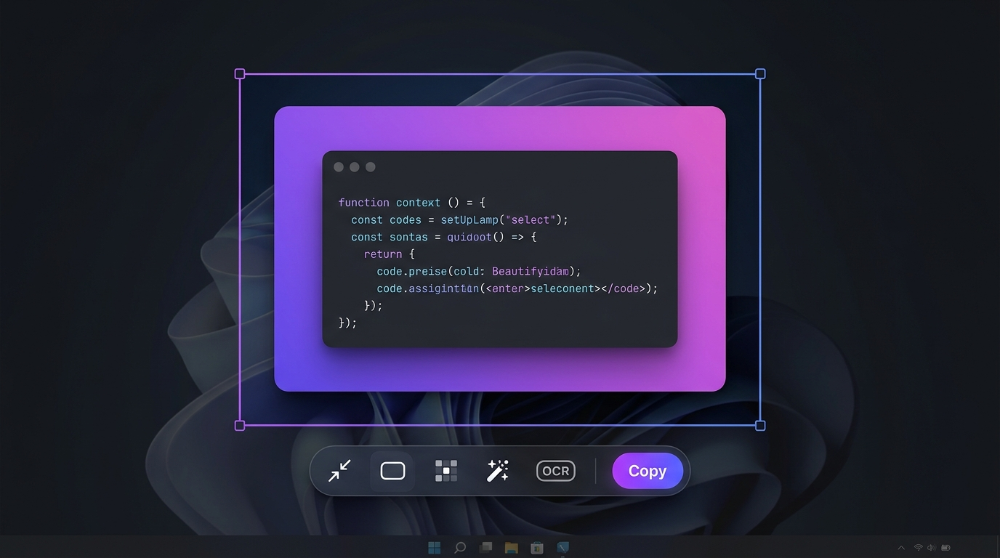

<div align="center">



<br>

<h1>📸 SnapShot</h1>
<p><b>Modern, lightweight <code>PrintScreen</code> screenshot & offline OCR tool for Windows 10 / 11</b><br>Crisp 1:1 DPI capture, built-in editor with blur & arrows, CleanShot-style Beautify, and offline WinRT OCR.</p>

[](https://github.com/raiyaxkrash/snapshot/releases/latest)
[-0078D4?style=flat-square&logo=windows&logoColor=white)](https://github.com/raiyaxkrash/snapshot/releases/latest)
[](https://tauri.app/)
[](https://www.rust-lang.org/)

<p align="center">
  <a href="README.md">🇷🇺 Русский</a> &nbsp;·&nbsp; <b>🇬🇧 English</b>
</p>

<a href="https://github.com/raiyaxkrash/snapshot/releases/latest/download/SnapShot-0.1.1-x64-setup.exe"></a>&nbsp;&nbsp;<a href="https://github.com/raiyaxkrash/snapshot/releases/latest/download/snapshot-0.1.1-x64-portable.exe"></a>

</div>

---

## 🚀 Features
- **Instant multi-monitor `PrintScreen`** — native `BitBlt` 1:1 DPI capture across the entire virtual screen.
- **Built-in editor** — arrows, rectangles, freehand pen, **pixelate/blur tool** for hiding passwords & tokens, undo (`Ctrl+Z`).
- **Beautify (`✨`)** — one-click gradient background, rounded corners, and soft shadow (CleanShot X style).
- **Offline OCR (`Ctrl+Shift+O` or `OCR` button)** — powered by native Windows WinRT `Windows.Media.Ocr` (works offline, auto-copies recognized text).
- **Universal clipboard & save** — copies both `PNG` and `CF_DIB` (`Enter` / `Ctrl+C`), saves to `Pictures\SnapShot\` (`Ctrl+S`).

## ⌨️ Hotkeys
| Action | Shortcut |
| :--- | :--- |
| **Capture region** | <kbd>PrintScreen</kbd> or left-click tray icon |
| **Instant OCR region** | <kbd>Ctrl</kbd> + <kbd>Shift</kbd> + <kbd>O</kbd> |
| **Copy to clipboard** | <kbd>Enter</kbd> or <kbd>Ctrl</kbd> + <kbd>C</kbd> |
| **Save PNG** | <kbd>Ctrl</kbd> + <kbd>S</kbd> |
| **Undo annotation** | <kbd>Ctrl</kbd> + <kbd>Z</kbd> |
| **Cancel** | <kbd>Esc</kbd> |

## 🛠️ Build from source
```bash
git clone https://github.com/raiyaxkrash/snapshot.git
cd snapshot
npm install
npm run build
```
