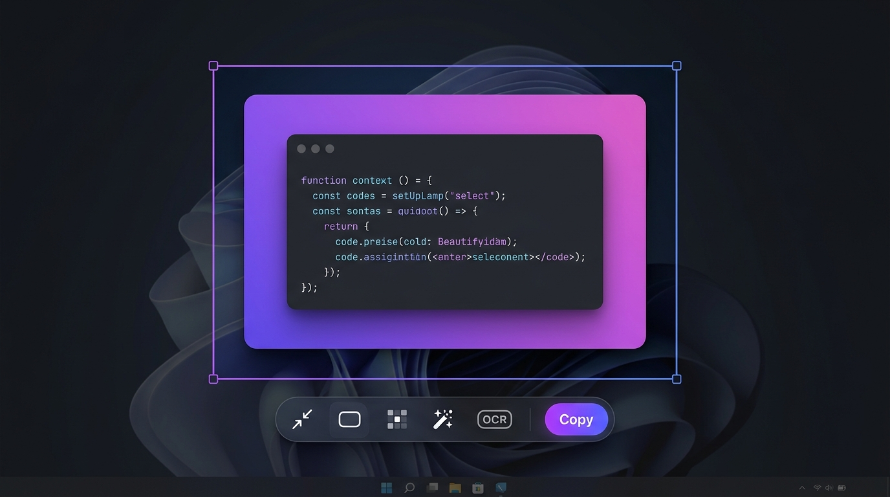
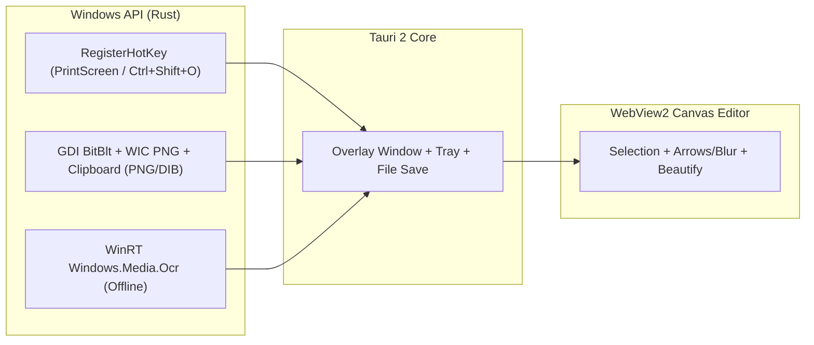

<div align="center">



<br>

<h1>📸 SnapShot</h1>
<p><b>Современный, лёгкий <code>PrintScreen</code> скриншотер и оффлайн OCR для Windows 10 / 11</b><br>Мгновенный захват 1:1 DPI, редактор со стрелками и размытием паролей, Beautify-фон и распознавание текста без интернета.</p>

[](https://github.com/raiyaxkrash/snapshot/releases/latest)
[-0078D4?style=flat-square&logo=windows&logoColor=white)](https://github.com/raiyaxkrash/snapshot/releases/latest)
[](https://tauri.app/)
[](https://www.rust-lang.org/)
[](https://github.com/raiyaxkrash/snapshot)

<p align="center">
  <b>🇷🇺 Русский</b> &nbsp;·&nbsp; <a href="README.en.md">🇬🇧 English</a>
</p>

<p align="center">
  <a href="#install">Скачать</a> &nbsp;•&nbsp;
  <a href="#features">Возможности</a> &nbsp;•&nbsp;
  <a href="#controls">Горячие клавиши</a> &nbsp;•&nbsp;
  <a href="#architecture">Архитектура</a> &nbsp;•&nbsp;
  <a href="#build">Сборка</a>
</p>

<a href="https://github.com/raiyaxkrash/snapshot/releases/latest/download/SnapShot-0.1.1-x64-setup.exe"></a>&nbsp;&nbsp;<a href="https://github.com/raiyaxkrash/snapshot/releases/latest/download/snapshot-0.1.1-x64-portable.exe"></a>

</div>

<br>

<table>
  <tr>
    <td width="25%" valign="top">
      <b>⚡ Захват 1:1 DPI</b><br>
      <sub>Нативный <code>BitBlt</code> по всему виртуальному экрану (все мониторы сразу) и кодирование PNG через WIC.</sub>
    </td>
    <td width="25%" valign="top">
      <b>✨ Режим Beautify</b><br>
      <sub>Градиентный фон, скругление углов и мягкая тень в 1 клик (как CleanShot X) — красиво для чатов и GitHub.</sub>
    </td>
    <td width="25%" valign="top">
      <b>▦ Размытие и аннотации</b><br>
      <sub>Стрелки, рамки, карандаш, 5 цветов, пикселизация паролей/токенов и отмена <code>Ctrl+Z</code>.</sub>
    </td>
    <td width="25%" valign="top">
      <b>🔤 Оффлайн OCR</b><br>
      <sub>Распознаёт русский и английский текст с экрана через встроенный WinRT <code>Windows.Media.Ocr</code> без облаков.</sub>
    </td>
  </tr>
</table>

---

<a id="features"></a>

## 🚀 Возможности

- **Мгновенный `PrintScreen` на всех мониторах** — замораживает весь виртуальный экран без артефактов масштабирования и позволяет выделить любую область с живым счётчиком размеров (`W × H`).
- **Встроенный быстрый редактор** — рисуйте стрелки (`↗`), рамки (`□`), пометки карандашом (`✎`), скрывайте пароли и личные данные инструментом пикселизации (`▦`) и отменяйте шаги по `Ctrl+Z`.
- **Beautify (`✨`) в 1 клик** — мгновенно оборачивает скриншот в стильный градиентный фон со скруглением и мягкой тенью.
- **Оффлайн OCR (`Ctrl+Shift+O` или кнопка `OCR`)** — выделите текст на картинке, видео, PDF или в игре: встроенный движок `Windows.Media.Ocr` распознает его локально и сразу скопирует в буфер обмена.
- **Универсальный буфер и сохранение** — копирует сразу в двух форматах (`PNG` + `CF_DIB`), поэтому вставка работает везде (Telegram, Discord, Chrome, Paint, Word), а `Ctrl+S` сохраняет файл в `Pictures\SnapShot\`.

---

<a id="controls"></a>

## ⌨️ Горячие клавиши

| Действие | Сочетание |
| :--- | :--- |
| **Сделать скриншот области** | <kbd>PrintScreen</kbd> или левый клик по значку в трее |
| **Мгновенный OCR текста с экрана** | <kbd>Ctrl</kbd> + <kbd>Shift</kbd> + <kbd>O</kbd> |
| **Скопировать скриншот в буфер** | <kbd>Enter</kbd> или <kbd>Ctrl</kbd> + <kbd>C</kbd> |
| **Сохранить в `Pictures\SnapShot`** | <kbd>Ctrl</kbd> + <kbd>S</kbd> *(также копирует в буфер)* |
| **Отменить последнее действие** | <kbd>Ctrl</kbd> + <kbd>Z</kbd> |
| **Отменить захват** | <kbd>Esc</kbd> |

---

<a id="install"></a>

## 📦 Установка

1. Скачайте свежий релиз со [страницы Releases](https://github.com/raiyaxkrash/snapshot/releases/latest):
   - **`SnapShot-0.1.1-x64-setup.exe`** — классический установщик для текущего пользователя.
   - **`snapshot-0.1.1-x64-portable.exe`** — портативный один файл без установки.
2. Запустите **SnapShot** — значок появится в системном трее, а <kbd>PrintScreen</kbd> и <kbd>Ctrl</kbd>+<kbd>Shift</kbd>+<kbd>O</kbd> заработают сразу.

> [!NOTE]
> **Windows SmartScreen:** бинарник пока не подписан платным сертификатом Authenticode. При первом запуске нажмите **Подробнее → Выполнить в любом случае** — или соберите приложение самостоятельно из исходного кода.

---

<a id="architecture"></a>

## 🧩 Архитектура



<details>
<summary><b>📁 Структура исходного кода</b></summary>

```text
snapshot/
├── src-tauri/src/
│   ├── lib.rs       # Инициализация Tauri, трей, IPC-команды, управление оверлеем
│   ├── capture.rs   # Захват виртуального экрана BitBlt, WIC PNG, буфер PNG+CF_DIB, сохранение
│   ├── ocr.rs       # Оффлайн-распознавание текста через WinRT Windows.Media.Ocr
│   ├── hotkeys.rs   # Глобальные горячие клавиши PrintScreen и Ctrl+Shift+O
│   └── main.rs      # Точка входа Windows
└── ui/
    ├── index.html   # Оверлей выделения и плавающая панель инструментов
    ├── style.css    # Стили оверлея, палитры и кнопок
    └── app.js       # Canvas-редактор, стрелки, пикселизация, Beautify-экспорт
```

</details>

---

<a id="build"></a>

## 🛠️ Сборка из исходников

Понадобятся **Node.js 20+** и **Rust** (`stable-x86_64-pc-windows-msvc`).

```bash
git clone https://github.com/raiyaxkrash/snapshot.git
cd snapshot
npm install

# Запуск в режиме разработки
npm run dev

# Проверка JS, Clippy и тестов Rust
node --check ui/app.js
cargo clippy --manifest-path src-tauri/Cargo.toml --all-targets -- -D warnings
cargo test --manifest-path src-tauri/Cargo.toml

# Сборка релиза и NSIS-установщика
npm run build
```

---

<div align="center">
Сделано на <b>Rust + Tauri 2</b> · Если проект оказался полезен — поставьте ⭐!
</div>
